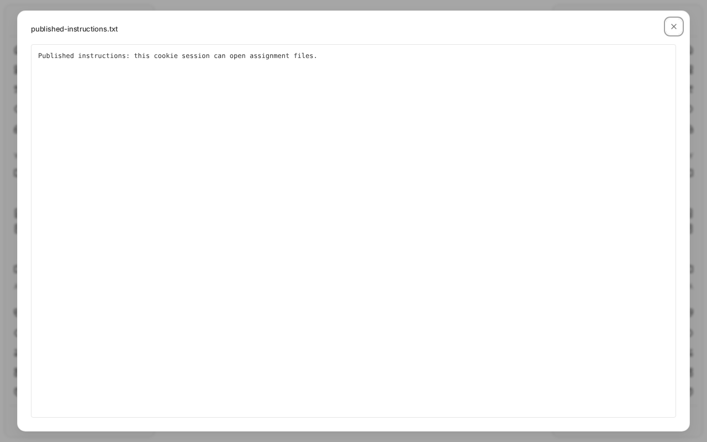
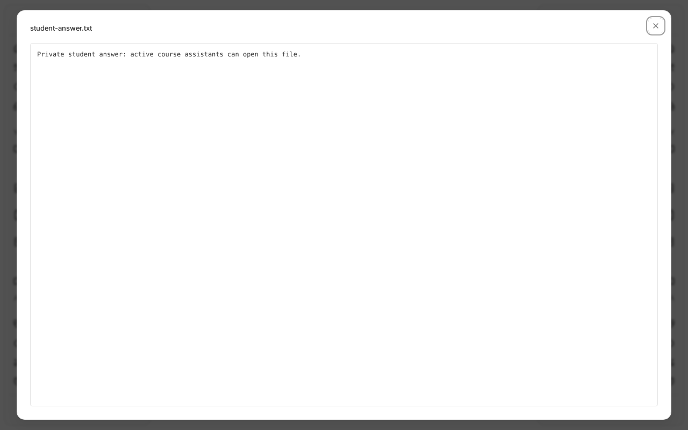

# LMS attachment access verification

Verified against canary base `b534067ac227beda0c89970b1d749442fce77ae9` on 2026-10-25.
All data was disposable: an isolated SQLite database, uploads directory, course,
student, teacher, and assistant. The managed canary checkout, phone preview,
and live courses were not used.

## Before and after

The same HTTP reproduction against the original code and the fix produced:

| Request / behavior | Before | After |
| --- | --- | --- |
| Student cookie-only course resource download | 401 | 200 |
| Student bearer course resource download | 200 | 200 |
| Draft attachment appears in student's course artifact list | Yes | No |
| Student draft metadata | 200 | 403 |
| Student draft download URL | 200 | 403 |
| Student draft local content | 200 | 403 (regression test) |
| Assistant submission detail | 200 | 200 |
| Assistant bearer submission file download | 403 | 200 |
| Student clicks published attachment in browser | Redirect to Login | File preview opens |

The browser check used the production Vite bundle served alongside the backend
on a separate local port, with real login and an HttpOnly session cookie.
No bearer token was placed in localStorage or sessionStorage. After fixing auth,
the browser exposed a second failure: Axios combined `/api` with the returned
`/api/v1/...` content URL as `/api/api/v1/...`. Resolving the returned URL against
an absolute API base fixes the actual content request too.

Before: clicking the published assignment attachment redirected the student to Login.


After: the student opens the same published assignment attachment and sees its text.



After: the active assistant opens the private student attachment from the submission drawer.



A separate course-content file button successfully downloaded `course-resource.txt`
(69 bytes); the downloaded bytes matched the disposable source. Both URL generation
and local content returned 200 and the student stayed on the course page.

## Policy

- Assignment-scoped files require an actual assignment association: the legacy
  direct foreign key or an assignment attachment link. A course hint alone grants
  no access. Active course members may read published and closed assignment files;
  drafts remain available to creators, admins, and authorized course staff.
- Shared assignment files are readable through any published/closed association
  in a course the viewer can access. Adding a draft association does not revoke
  legitimate published access. Course and assignment listing filters also follow
  these associations so the published attachment remains discoverable even when
  its scope hints point at the newer draft. A published association in an unrelated course
  does not grant access. Assignment lifecycle rules are unchanged.
- Explicit private, course, and public sharing levels retain their meaning.
  Merely linking a private file to an assignment does not publish it. Likewise,
  adding a draft link does not retract an already shared course/public resource.
  Use a separate private upload for different draft-only content.
- Assistants may read private student files through the actual submission and its
  course, using the existing active course staff policy. Artifact scope hints
  do not grant assistants blanket access to private files. Removed assistants,
  assistants from unrelated courses, and other learners remain denied.
- Cookie downloads use normal session validation. Legacy extension job delegation
  remains explicit-bearer and download-only, with its existing type, purpose,
  job, extension, and user checks. This does not broaden execution token scopes.

## Validation

- 27 new backend regressions cover cookie-only resources, draft/published/closed
  files across listing, metadata, original and derivative download URLs, direct
  local content, and redirect downloads; shared links; private sharing; assistant,
  owner, and learner access; removed and unrelated membership; invalid/expired,
  action, wrong-type, and incomplete delegation tokens over cookie and bearer.
- 85 existing focused backend tests passed: artifact API/download/permissions/
  lifecycle, LMS security/memberships/lifecycle/primitives, auth integration,
  execution authorization, and extension auth.
- Frontend `bun run test --maxWorkers=2`: 62 passed, 5 failed. The unchanged base
  had 60 passed and the same 5 setup failures (missing SidebarProvider and
  matchMedia). Both new real-Axios URL tests passed. An earlier unrestricted run
  exhausted worker-start timeouts under shared machine load; limiting workers
  completed normally.
- `bun run build` passed. Ruff checks and `git diff --check` passed.

Backend commands use `uv run pytest`; `FAIR_DATA_DIR` was set to disposable
storage. The new tests also redirect uploads into pytest's temporary directory.

The final backend run used:

```sh
FAIR_DATA_DIR=/tmp/fair-attachment-pytest uv run pytest -q \
  tests/test_lms_attachment_access.py tests/test_artifact_api.py
```

## Limits

Browser and byte-level content checks used local storage. S3 download URL issuance
uses the same authorization policy, but no live S3 bucket was exercised. Already
issued S3 presigned URLs retain their existing expiry behavior; this change does
not revoke them. Artifact listing still uses the existing per-artifact permission
checks; this change does not redesign query performance or course-item visibility.
